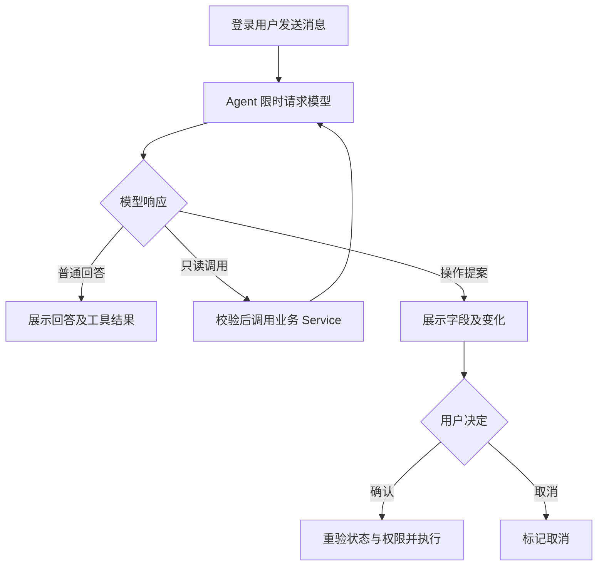

# C-7 智能学习助手

助手通过 Spring AI 的原生函数调用读取当前用户的学习数据，并为任务变更和日计划草案生成确认卡片。业务数据由既有 Service 读取和写入。应用启用 AI 后，在登录后的导航中打开「AI 助手」。

## 本地配置

使用仓库 README 中的普通前后端启动流程。真实模型需要显式设置后端环境变量 `AI_ENABLED=true` 和 `DEEPSEEK_API_KEY`，可用 `DEEPSEEK_MODEL` 指定账号支持的模型。Agent 使用独立的 Spring AI ChatModel，沿用现有 DeepSeek Chat Completions 配置，使用原生工具定义和响应消息，关闭 thinking 和框架自动工具执行。既有 Learning Path 与每日计划模型仍由各自的网关处理。默认测试的模型响应在本地构造。

DeepSeek 的 [Tool Calls](https://api-docs.deepseek.com/guides/tool_calls/) 与 [Chat Completions](https://api-docs.deepseek.com/api/create-chat-completion) 定义了本实现使用的协议。线协议测试捕获实际 Spring AI HTTP 请求，覆盖工具定义、模型 tool_calls、带相同 call ID 的 tool 结果和最终回答。它使用本地拦截的模型响应，线上账号、配置模型与真实供应商的组合仍需联调。

## 工具

| 名称 | 作用 |
|---|---|
| `list_subjects` | 当前用户的科目，最多 20 条 |
| `list_goals` | 分页查询当前用户的目标 |
| `today_tasks` | 真实待办和顺延任务，返回前 12 条及总数 |
| `open_tasks` | 分页查询未完成任务，可按标题缩小范围或仅查逾期 |
| `study_records` | 分页查询学习记录，可指定日期范围 |
| `study_statistics` | 查询学习时长、记录数、活跃天数等汇总 |
| `learning_paths` | 查询路径列表或按 ID 查看执行进度 |
| `search_knowledge` | 使用当前 C-4 检索查询本地知识，最多 4 条 |
| `propose_task_create` | 生成任务创建预览，确认后写入 |
| `propose_task_update` | 比较原值与新值，确认后修改标题、描述、时长、优先级、计划日或截止时间 |
| `propose_study_plan` | 用已查询任务生成日计划草案，确认后可进入现有每日计划页编辑和保存 |

## 每轮流程与授权



会话绑定当前登录账号。API 前缀是 `/api/v1/agent/sessions`，支持创建、列表、详情、发送消息和提交动作决定。所有工具从服务端登录上下文取得身份。Tool Registry 带 JSON Schema，并在读取、绑定 DTO 和 Bean Validation 时拒绝未知工具、额外字段及非法参数。任务的编辑和计划草案只接受在当前轮成功读取到的任务。创建动作校验所属科目与目标，确认时服务层再次校验。工具输出作为 tool message 返回，系统提示指定它是数据。模型可以提议操作，确认端点是执行入口。

待确认动作绑定会话、随机 ID、用户、动作类型、摘要和期限。客户端提交确认或取消时只发送动作摘要和决定。后端执行原始提案，调用任务 Service 的归属验证和锁定比较，原任务改变后需要重新预览。会话锁覆盖整个动作事务，已执行、失败、取消及过期均为终态，同一动作的后续决定会返回已有状态。计划草案确认重查真实候选并比较排程；到「每日计划」后可以调整并用现有确认按钮保存计划。

每轮最多 6 次工具调用，重复的工具和规范化参数只执行一次。输入最多 2000 字符，模型回答最多 4000 字符，单个工具结果最多 6000 字符。模型轮次共享 30 秒预算，使用最多 4 个并发模型工作线程。每个工具或确认事务的目标上限为 5 秒并使用 JDBC 事务超时，底层连接池获取、驱动或网络仍可能延迟返回。日志记录请求、工具、耗时、错误码、操作终态，不携带原始提示词或工具内容。

会话单进程内存保存，闲置两小时到期。每用户 10 个活跃会话，全局最多 200 个。每个会话最多保留 30 条消息，最近 12 条供下一轮参考，一次最多一个待确认动作，10 分钟失效。重启、过期会丢失聊天和未完成提案。跨实例无会话共享，生产扩容前需引入共享状态及持久化幂等。任务变更与已保存的每日计划存入既有数据库。

## 三条可复现实例

先准备真实数据。今日有待办，明日有可选的 RAG 任务，另有一个未完成的 Spring Boot 任务。使用各自的学习科目。测试中日期固定为 2026-11-19 上海时间。

| 输入 | 页面与预期结果 | 自动化证据 |
|---|---|---|
| 帮我看看今天还有什么任务没有完成。 | 展开「今日任务」，可看到业务服务提供的任务。再问一个问题，当前对话继续。 | `AgentWorkflowTest.todayTasksUsesRealResultInToolProtocolAndSupportsFollowUp` 验证 HTTP 到工具协议及历史。 |
| 明天下午帮我安排两个小时学习 RAG。 | 按标题查候选，预览次日 14:00 起的 120 分钟草案。确认后进入每日计划编辑。真正保存由每日计划的确认按钮完成。 | `AgentWorkflowTest.tomorrowPlanUsesOwnedCandidatesAndReturnsDraftAfterApproval` 使用真实规则排程器与测试候选，验证用户范围和确认后的草案。 |
| 把我的 Spring Boot 任务调整到后天。 | 预览原日期与新日期，确认后到任务页查看。取消时保留原日期。 | `AgentWorkflowTest.springBootRescheduleShowsDiffAndWritesOnlyOnceAfterConfirmation` 验证确认前无更新且重复确认仅调用一次。 |

测试使用 MockMvc、模拟模型以及测试业务数据，覆盖无效工具、非法参数、跨用户访问、幻觉 ID、重复调用、事务超时、提示注入、拒绝、过期、任务快照过时、供应商不可用和多轮历史。构建与测试：

```sh
cd backend
mvn clean test
mvn package -DskipTests
cd ../frontend
npm ci
npm run test:progress
npm run build
```
