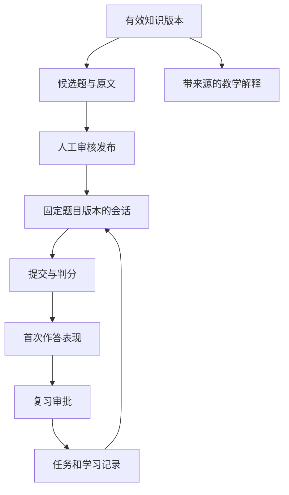

# C-13 学习测评与证据教学

C-13 增加从出题、审核、作答到复习和再次测评的流程。学习时长、路径完成状态、用户自评与测评表现分别保存。在应用首页选择 **学习测评** 开始使用。分支基于 C-12.1 合并提交 `f3f1ca89b52b19a6dfd2d22bf142e9938af12c7c`。

## 使用流程

1. 审核员在知识中心发布和目标知识点匹配的资料，登记精确的软件版本。事务代理示例使用 Spring Framework 6.2 的 [事务注解文档](https://docs.spring.io/spring-framework/reference/6.2/data-access/transaction/declarative/annotations.html)。
2. 在 **题库与出题** 选择知识点、难度、软件版本与题型，生成 3–10 道候选。普通用户可以维护个人题库。公共题库沿用 `APP_KNOWLEDGE_REVIEWERS`。
3. 检查题干、唯一性、版本、答案、Rubric 和来源。记录核验理由后按草稿、待审核、通过、发布推进。审核入口保留原文和出处。已有题目的 API 修订产生独立版本。
4. 从知识点、路径、错题或综合范围启动测评。暂存答案后可刷新或重新登录恢复。提交前仅可见题干和选项。简答辅助反馈需主动请求并确认数据发送。
5. 在 **错题本** 检查答错的题及审核解析。**知识表现** 显示首次有效作答、复练和不同难度的样本。已有路径节点匹配时，在 **学习洞察 → 复习建议** 审批真实复习任务。
6. Agent 工作流可读取真实测评结果、预览练习或下周复习。批准后才建立会话或复习任务。完成复习且有学习记录后，用同版本同难度的新题观察变化。



## 数据和权限

| 迁移 | 数据 | 约束 |
| --- | --- | --- |
| V12 | 稳定题目 ID、不可变的题目定义和版本、审核轨迹 | 选项、Rubric 与解析保存在版本 JSON。版本引用固定文档版本和片段序号。发布更高修订会归档旧 revision。 |
| V13 | 用户会话、固定题目版本、暂存、结果、辅助反馈 | 会话行锁保护作答、取消和提交。重复提交返回原成绩。历史题目与评分规则可追溯。 |

公共题的来源为登记且已发布的公开文档。私人题只向作者开放。知识源撤回、被新版替换或不再有权访问时，题目在管理视图显示来源需复核，并停止进入新测评。历史公共测评保留题目、历史证据和评分，历史私人证据仍按当前访问范围处理。会话默认有效 24 小时，最多同时保留 10 场有效未提交会话，一场 1–20 题。

出题校验使用 C-11 RAG 检索、证据预算和当前版本检查。模型引用和参考答案必须与同一证据相符，且单选正确选项必须等于有引文支持的参考答案。重复检查忽略大小写、全角和标点。题干歧义、语义近重复、难度和答案含义仍由审核者核验。模型只生成候选内容，服务端分配状态。

选择题评分规则 v1 比较选项索引。发布时审定的干扰项分类提供错因证据。简答返回 `NEEDS_REVIEW`，可选模型反馈逐项标记评分点、可能事实错误、版本疑点及其作答原文。简答辅助反馈始终独立于正确率和表现等级。

## 知识表现和复习

- 表现按知识点和软件版本分组，使用已审核公共题的首次有效单选结果。已经做过同一题 ID 的后续成绩进入复练列，修改题目版本也沿用原题 ID。
- 默认至少 3 个首次作答样本。少于门槛为数据不足。连续 3 次首次作答错误或正确率低于 60% 为需要加强，达到 85% 为表现稳定，其余为基本理解。阈值用于描述测评表现。查询最多 600 个判分样本并标记截断。
- 可匹配的现有 Learning Path 节点复用 `LearningReviews`、用户身份、自评、延后、审批和周期幂等约束。弱项会把复习建议提前，显示与自评的差异。
- 前后对比以完成任务和实际复习记录为前提，在前后各 14 天内对照同版本、同难度的新题。列表显示分子和分母。任务完成本身不会修改成绩，观察到的变化无法单独说明复习的因果效果。

## 接口与 Agent

路径均位于 `/api/v1`。

| 路径 | 用途 |
| --- | --- |
| `GET /assessments/topics`、`/assessments/questions` | 知识点和可练习题目摘要 |
| `POST /assessments/generate` | 创建候选草稿，返回状态与模型用量 |
| `/assessments/manage/questions[/...]` | 创建、查看、修订、审核、发布及归档 |
| `/assessments/sessions[/...]` | 启动、恢复、暂存、提交、取消、查看历史和简答反馈 |
| `GET /assessments/performance`、`/assessments/wrong-answers`、`/assessments/review-progress` | 表现、错题、复习前后对比 |
| `POST /knowledge-hub/rag/explain` | 简单解释、技术原理、教学示例、概念比较 |
| `POST /knowledge-hub/rag/answer` | 原有原文证据问答 |

只读工具为 `get_assessment_history`、`get_knowledge_performance`、`list_weak_topics`、`get_wrong_answers`、`get_assessment_summary`、`list_assessment_topics`。提案工具为 `propose_assessment_practice`、`propose_assessment_review`。工作流通过既有审批状态和摘要授权复核再执行。复习提案检查未来七天的学习计划与给定容量，创建有计划日期的任务。现有自适应规划继续负责具体时间段。

教学解释先查当前公开资料，然后校验引用所在来源、版本、逐字引文及覆盖经人工复核的前提。可展示默认事务代理、ExecutorService、Spring AI 工具调用和 QuestionAnswerAdvisor 四条主题说明。模型负责从通过核验的说明里选择，后端负责渲染。不同措辞的资料可能无法匹配全部声明。此时保留原文供核验。教学示例保留未运行标记。

## 测试和可复现评估

```bash
cd backend
mvn clean test
mvn package -DskipTests
cd ../frontend
npm ci
npm run test:progress
npm run build
cd ..
node --test tests/c12-provider.test.mjs
```

MySQL 8、Redis 7 和 Chromium 使用 [C-12.1 验收流程](final-acceptance-c12-1.md) 中的本地隔离数据库配置。运行 `node tests/c8-e2e.mjs`，默认使用本地供应商夹具。C-13 新增覆盖五题出题到审核、多人权限、刷新和重启恢复、并发提交、撤回及历史版本、Agent 审批和复习前后对照。测试包含模拟发布的片段和合成用户，不产生供应商费用。

Maven 测试生成 `backend/target/c13-teaching-evaluation.json` 和 `backend/target/c13-rubric-evaluation.json`。报告中记录每条案例、参考结果和固定回复。详细结果见 [C-13 质量评估](learning-assessment-c13-evaluation.md)。

`C13_LIVE_ASSESSMENT=true C12_LIVE_DEEPSEEK=true node scripts/run-live-c12.mjs` 可在配置模型名、密钥、隔离数据库、调用次数、Token、费用及单价上限后显式运行真实供应商扩展。命令使用合成场景，尝试生成后仍须通过全部结构和引用检查。缺密钥时状态为 **NOT_RUN**。CI 使用固定响应。

生成、简答辅助及教学选择共用单进程每日 30 次的模型调用预算（`APP_ASSESSMENT_DAILY_MODEL_CALLS` 可配置），最多两次并发。每次只有一次供应商调用，连接和读取各不超过 15 秒，回复上限取现有 Token 配置和 4800 的较小值。默认保持项目的 AI 关闭配置。

## 已知限制

- 简答保留待复核与独立辅助结果，暂无人工录入正式简答分数的接口。
- 教学解释的可输出范围取决于已审核说明和当前已发布片段。原文引用一致并不能单独证明模型解释可靠。
- 路径与知识点使用规范化标题匹配。无法匹配时仍可查看错题和表现，但不能从现有路径审批生成该节点的复习任务。
- 题库与表现的首版查询采用固定分页或上限。审核流程的语义核验依赖人工，尚无跨用户大规模一致性或学习效果对照研究。
